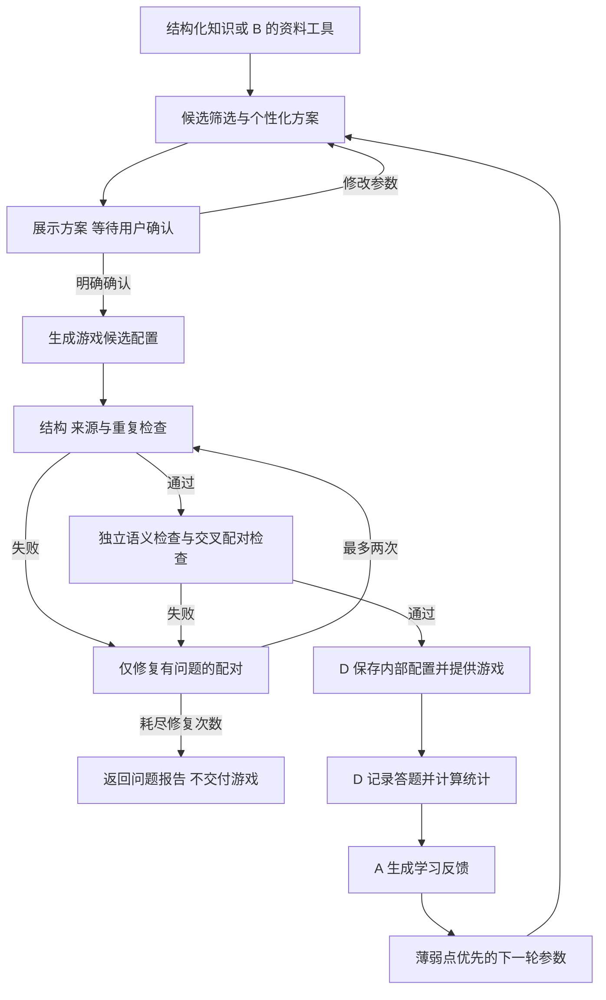

# Agent 工作流与工具调用

本实现使用单个主 Agent 调度专用工具。宿主程序控制阶段与发布条件，模型在当前工具列表中返回真实 function call。程序按 Schema 校验参数、执行函数，并将结果连同原始 tool_call_id 回传后续模型请求。

## 工作流



资料工具阶段可选：读取材料 → 分析选定图像 → 提取知识。B 的真实工具尚未接入时使用 KnowledgeBundle 样例，不伪装成自动解析或视觉理解。

## 工具列表

| 工具 | 允许阶段 | 参数 | 输出/约束 |
|---|---|---|---|
| `read_material` | 资料读取 | material_id | B 的文本块和图像列表；限定当前材料 |
| `analyze_image` | 资料理解 | image_id | B 的真实视觉结果；图像必须属于当前材料 |
| `extract_knowledge` | 资料理解 | material_id | 所有必需图像分析后返回 KnowledgeBundle |
| `design_matching_plan` | 方案设计 | 空对象 | 根据宿主绑定的知识与用户偏好输出方案 |
| `generate_matching_config` | 已确认的生成阶段 | plan_id | 只生成候选，不直接交付 |
| `validate_matching_config` | 候选生成或修复后 | plan_id | 先确定性检查，再单独请求模型审阅全部配对 |
| `repair_matching_config` | 上次检查失败 | plan_id | 修改问题配对，保留有效配对与确认范围 |
| `generate_learning_feedback` | 会话结束 | session_id | 使用宿主绑定的统计与知识生成建议 |

工具没有任意文件读取、网络地址、命令执行或代码生成参数。知识全文和用户偏好由宿主绑定，模型无法在工具参数中偷偷换一份材料或改变确认结果。

计划、生成、语义检查、修复和反馈分别有独立 Prompt。需要内容生成的工具内部使用 JSON 输出模式，并由 Pydantic 校验。语义审阅采用同一模型的独立请求，输入来源证据与完整游戏，不依赖生成器声称的正确性；这仍然属于模型自检，有相关性误差。

## 真正的调用循环

```text
发送 system/user messages 和当前允许的 tools
← 模型返回 assistant.tool_calls
验证名称、参数、call_id 和当前阶段
执行工具（内容工具可能再发起一次结构化模型请求）
追加 assistant 工具请求与 role=tool 的执行结果
→ 下一轮模型读取工具结果，选择验证或修复动作
宿主在最终验证通过后返回结构化结果
```

末端工具完成全部前置条件后，宿主直接返回已校验结果，不再额外请求模型复述结果。中间工具结果会在下一轮继续决策时发送回模型。没有 tool_calls 的纯文字回复不能替代业务结果；纠正一次后仍不调用工具即失败。

## 预算与故障处理

- 每阶段最多 12 次逻辑模型请求，包括内容工具内部的结构化请求；最多 12 次工具分发。无效、未知和重复调用也消耗工具预算。
- 结构或语义修复最多两次，失败的补丁也计数。候选不会因模型输出“已通过”而跳过检查。
- 每次 HTTP 请求超时 60 秒；超时、连接错误、429 和 5xx 最多重试两次，间隔为 1 秒和 2 秒。SDK 内置重试关闭，避免重试叠加。
- 一次逻辑请求最多产生三次 HTTP 尝试；重试不增加逻辑请求上限，但实际 HTTP 次数在真实运行 manifest 中记录。
- 400/401/403 等请求错误直接失败，不更换模型、不回退离线。
- 修复工具返回的 ID 集合必须与受影响配对完全一致，其他配对逐字段保留。缺失或结构损坏的槽位按确认方案重建后修复。
- 需要改变题量或知识范围时由用户重新规划；本版不自动发布“缩水”的已确认游戏。

阶段预算并不等同于任务总时限。D 应配置任务级超时与取消，并将进程重启导致的中断任务标记失败，允许用户重新发起。

## 来源、隐私与边界

来源证据和卡片文字作为 JSON 数据放入用户消息，不拼成系统指令。Prompt 明确要求忽略材料中的工具请求和角色覆盖。测试验证这种分隔、阶段限制及日志脱敏；真实模型的注入鲁棒性仍需用独立对抗材料评估。

日志只记录事件、允许的工具名、字段/数量/状态摘要、耗时和后续动作。模型请求正文、密钥与完整来源不写入日志。`runs/`、`.env` 已忽略；游戏与反馈结果仍含知识内容，应按 D 的数据保留规则存储和清理。

命令行会说明真实模式向外部 API 发送知识与证据。正式 Web 产品中的告知、文件权限、删除入口、上传限制、会话身份绑定和任务持久化由 B/C/D 完成。
