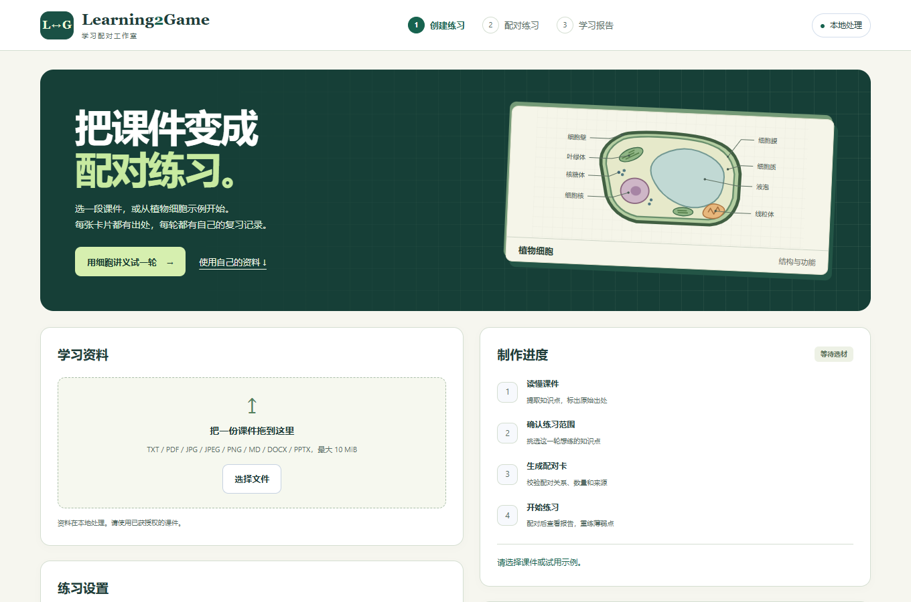
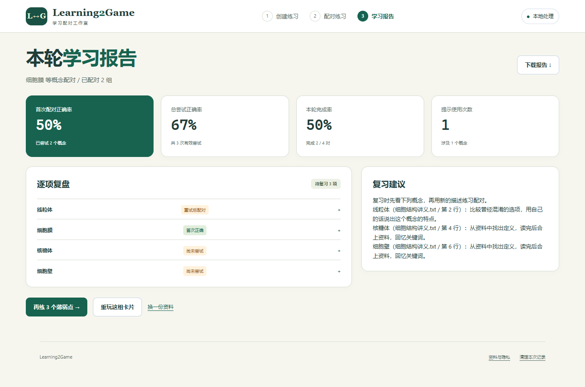

# Learning2Game 学习配对工作室

将自己的讲义、课件或图示做成一局配对练习。学生可以在开局前调整知识点和难度，配对时查看线索，结束后按知识点回看出处，再用容易混淆的概念开一局。教师也可以用同一份讲义准备课堂活动。



## 在自己的电脑上打开

1. 安装 Python 3.11 或更高版本，下载或克隆这个仓库。
2. Windows 用户双击仓库根目录的 **start.cmd**。在 Windows、macOS 或 Linux 的项目目录，也可运行下面的命令。

```shell
python run.py
```

首次启动会建立项目专用的 Python 环境并安装依赖，需要联网。服务准备好后，启动器会打开浏览器。默认首页是 `http://127.0.0.1:8000/`，这个地址连接运行启动器的电脑。使用期间请保持终端打开，结束时按 Ctrl+C。端口被占用时可运行 `python run.py --port 8001`。

## 试一局

1. 在创建页选用示例讲义，或上传自己的资料。第一次体验可用带有“术语：定义”的 TXT 文件。
2. 选择学习目标和题量，查看知识点和出处，修改并确认方案。
3. 依次选择左、右卡片进行配对。试着配错一次，再用一次提示。
4. 结束练习，在报告中对比首次正确率、总尝试正确率和完成率。选择重点再练，确认下一局的知识点。

模型模式另有一份可重复验收的[校园打印图文讲义](public/examples/campus-printing.pdf)。第一页是文字，第二页是带箭头和标签的图片。用它可以观察哪些卡片来自段落，哪些来自图中的关系。



## 两种处理方式

| 模式 | 能做什么 | 配置 |
| --- | --- | --- |
| 本地离线 | B 解析真实资料，用规则识别带定义的知识点。A 按资料组题、校验和生成反馈。支持 TXT、Markdown、PDF、DOCX、PPTX 中的文本。 | 默认启用，业务运行全程本地。 |
| 模型模式 | B 分析文字与图像，抽取带证据的概念和图示关系。A 通过模型调用工具生成方案、卡片和建议。另支持直接上传 PNG/JPEG。 | 复制 `.env.example` 为 `.env`，设置 `EDUGAME_MODE=live` 及两组服务参数，重启应用。 |

资料、会话和报告保存在本地 `.local/`。模型模式会按配置向服务商发送课程内容，可能产生调用费用。课堂演示可使用自编讲义。凭证由后端读取。

## 组员维护入口

| 模块 | 代码 |
| --- | --- |
| A 配对 Agent | [工具编排与内容校验](PartA/src/matching_agent/)、[应用适配器](backend/agent_adapter.py) |
| B 资料理解 | [文档和图像读取](backend/material_processing.py)、[知识点、证据与质量检查](backend/material_adapter.py) |
| C 网页与游戏交互 | [网页源码](public/)、[浏览器验收](tests/browser/) |
| D 集成与学习记录 | [FastAPI 入口](backend/main.py)、[任务流程](backend/pipeline.py)、[判分和报告](backend/sessions.py) |
| RPG 答题战役后端 | [八卷远征、战术首领与进阶周目](docs/rpg-expedition.md)、[单卷战役](docs/rpg-battles.md)、[资料生成和会话对接](docs/rpg-backend-handoff.md) |
| RPG 烟柳渡首领战 | 启动后打开 `/rpg/battle/`，体验答题交战、营地修习和战后结算。[试玩与前端交接手册](docs/rpg-battle-frontend.md) |

运行后的 `/docs` 提供交互式 API 文档，`/health` 显示当前模式。[真实模型与浏览器验收记录](docs/acceptance.md)包括遗漏项、修正和实测耗时。API 调用顺序、配置、统计口径和数据清理方法见[对接与测试说明](docs/integration.md)。
