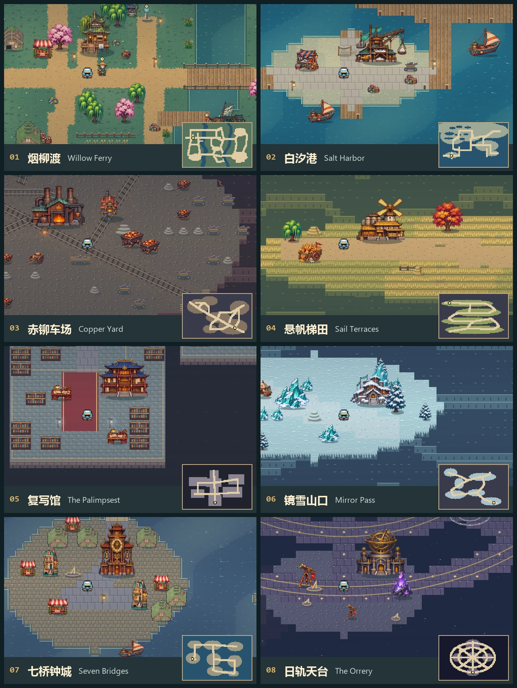

# 灯路远征

在仓库根目录运行 `python run.py`（Windows 也可双击 `start.cmd`），在工作室点 **进入远征 RPG**。浏览器在已经启动的服务地址后打开 `/rpg/` 也能进入同一游戏。游戏在 FastAPI 上读取关卡、存档与结算。将 HTML 文件单独拖进浏览器无法建立会话。

[从第一章走到第二章的实机短片](media/lantern-first-crossing.mp4) 展示跟随任务指引、守关战后返回交手处和从出口换章。[早期首领演示](media/lantern-road.mp4) 使用旧版短途测试档，展示灰冠龙将的两种战斗形态。

## 第一次出发

1. 选“启程”，挑职业和题目语言，上传一至八份课程文件，或直接用驿站手册。八章主线从烟柳渡开始，第八章在日轨天台迎战灰冠龙将。手册有 32 个知识点，每章四场战斗。上传的课程按收录题量排关，短讲义会留出几站供玩家打探消息、修复机关。旧短途存档可以在结算页用原资料重开八章。
2. 看左上的金色“主线”。WASD 或方向键移动，靠近人物、机关或船首按 **F** 互动。远处跟着屏幕边缘的箭头走，走近后箭头会落到目标上。点击任务文字可以自动寻路。右下“寻路”列出本章地点，手机方向键支持双指斜向移动，Esc 或右上“菜单”可打开游戏菜单。
3. 按本章任务行动。白汐港的伤员船在港外等引航，先到灯塔看水深、点航灯，再去码头见弩长。如果先碰上守卫，守卫面板会告诉你接下来去哪。比如在赤铆车场，点“去找铁匠铆青”就会沿轨道走到他面前。商定行动后，走入巡逻范围会开战，也可以在守卫面板上点“迎战守卫”。踩到陷阱会先出现说明，选“绕开陷阱”便可转身离开。
4. 选普攻、格挡或职业战技，再选刻印，点场上的对手出招。普通巡逻至少三轮，精英和地区首领至少四轮，灰冠龙将至少五轮。战场会标出“讲义题”“应用题”或“战术判断”，并显示本场已攻克几轮。答错后可以读“回合解析”，等这道题再次出现时重试。普通战胜利后在营地挑补给，回到交手处继续走。章末守关战胜利后，先回本章地图，沿箭头走到出口领补给才会进入下一章。击败灰冠龙将可查看结局。[力学试题实战短片](media/field-battle.mp4)
5. 在“队伍”里交谈并选一名伙伴上阵。渡口船工替队伍挡伤，锻师在普攻击中时追锤，守灯人协助蓄力。同行经历提高默契。回声塔和主线共用这支队伍，分别保存战场。塔层逐步从辨认、回忆发展到拼接多条证据。[回声塔与伙伴规则](rpg-tower-party.md)
6. 手记按已作答的知识点登记讲义原文、出处、正确次数。中英按钮可在探索、战斗、爬塔和读课件时使用。自带界面与故事有两种语言，原文保留在来源记录中。新建战役可用英文原卷生成中文练习。[课程格式与实测记录](course-rendering.md) 手记里的“讲义收录范围”按文件显示提取量、编入主线的数量，以及还需要补图或补解的题项。

## 对话与背包

和剧情人物交谈时，人物立绘及对话框出现在场景下方。按“下一句”听完对话，赶时间时点“跳过”直接看到可选行动。决定由玩家亲自选。故事进展可在手记中回看。

按 **E** 打开背包，再按 **E** 或 **Esc** 回到原处。触屏可点生命栏旁的“背包”。左侧是所选职业的立绘、生命、攻击、防御、蓄力和经验。右侧可浏览装备、道具和遗物。地图和营地允许换装、使用补给，也可以选择数量并确认丢弃。已穿戴的装备会保留，先换下再整理。野战绷带每份最多回复 12 点生命，凝神茶每份回复 1 格蓄力；调查本章机关可获得绷带，击败章节首领可获得茶。战斗时可以查看装备及剩余物资，关闭背包即可继续当前回合。

[赤铆车场的铁匠对话](media/lantern-npc-dialogue.webp) | [星纹术士的背包与换装预览](media/lantern-expedition-pack.webp)

## 八章路书

每章地图为 112 × 72 格，有三个可调查的地标。桥、水面、梯田台阶、室内隔墙和山崖会改变行走路线。中途想绕路看地标，点“主线”即可找回去。

修好机关后可以直接赶路。屏幕下方的记录提示显示三秒，调查结果保存在手记里。想重读现场记录，站在机关旁按 **F**。

| 地区 | 怎么走，沿途做什么 |
| --- | --- |
| 烟柳渡 | 从河岸木桥走向灵船，在船首听求救暗号。渡口水尺旁可以系缆。 |
| 白汐港 | 港湾把栈桥和盐堤隔开。沿码头走到灯塔，读三条水道的测深，点灯引船进港。 |
| 赤铆车场 | 沿斜穿车场的铁轨接近熔炉，支线通往矿坑和调车场。把矿车拨入冷却侧线，踩闸停稳后再挂安全钩。 |
| 悬帆梯田 | 顺梯阶在四层田埂间折返。从风索绞盘拉紧侧帆，再去见粮船领航员。 |
| 复写馆 | 从南门进入室内馆舍。中央走廊连着侧厅和编目室，去透光台读出折纸背面的暗号。 |
| 镜雪山口 | 顺冰脊和栈道绕过山崖，逐根牵试垂下的绳子，摸到冰下的回信后，敲一声木铃。 |
| 七桥钟城 | 桥把运河上的街区连在一起。拉钟绳，看两岸旗手让车停下，第三响拔销放桥。 |
| 日轨天台 | 两条环形星轨环绕中央平台。分别调准日环的朝向与仰角，让晨光照进信镜，在北侧迎战灰冠龙将。 |

## 故事与游戏设计

灰冠龙将用征名册征发八城守军。船舱中传出童年伙伴的求救暗号，守渡人把半块虎符交到玩家手里。在第一站登上灵船，玩家可以破舱救出赤翎的弩手，或夺取帅印令全船弃桨。下一站记得上次的选择。八站各有两条行动线，选择、占领的烽台和战后命令写入存档，手记可以重读。

救援可在决战开场恢复生命，每站 2 点，最多 8 点。夺取军资可削减龙将的开场护盾，每站 1 点，最多 2 点。龙将半血后打开胸炉，切换立绘与招式。胜利后可下令斩冠凯旋或留守星门。在至少三座驿站同时完成抉择和机关，联军即可越过星门发动反攻。旧版短途存档以原地区数计算。经典勇者讨伐的节奏参考发行方对《勇者斗恶龙 III》的介绍，平面探索参考《星露谷物语》的村镇场景。人物、地点和对白由本项目创作。[Square Enix 故事介绍](https://www.square-enix-games.com/en_GB/news/dragon-quest-iii-hd-2d-remake) | [Stardew Valley 官方实机图](https://www.stardewvalley.net/)

地图、地点日志、营地和楼层守护者参考了社区 RPG 以区域划分图鉴、让玩家从敌方行为中理解规则的做法。回声塔将高层压力放在证据组合、连续正确与敌方属性上。战斗的学习价值、主观难度与疲劳度仍适合用组员和同学试玩衡量。[Shattered Pixel Dungeon 作者仓库](https://github.com/00-Evan/shattered-pixel-dungeon)

## 实现与接手

| 入口 | 职责 |
| --- | --- |
| [world.js](../public/rpg/world/world.js)、[interface.js](../public/rpg/world/interface.js) | 标题、开局、漫游、点击与键盘交互、地图、补给、手记、结局、挂载与卸载战场 |
| [provision.js](../public/rpg/world/provision.js)、[fieldbook.js](../public/rpg/world/fieldbook.js) | 上传、提取、分卷、规划、确认发布、建立存档；分步记录 job ID，支持断线接续 |
| [atlas.js](../public/rpg/world/atlas.js)、[地区美术](../public/rpg/world/region-art/ASSETS.md) | 地图坐标、地区风景、居民证词、地标和各站结局 |
| [overland.js](../public/rpg/world/overland.js)、[overland-map.js](../public/rpg/world/overland-map.js)、[各区布局](../public/rpg/world/chapter-plans.js) | 按键、触控、寻路、镜头和战后原位恢复。烟柳渡保留两道河、五座桥，其余七区按各自的地形、路网和建筑计算碰撞与可达性 |
| [overland-art.js](../public/rpg/world/overland-art.js)、[music.js](../public/rpg/world/music.js) | 各地配色、行走动画、深度遮挡、环境光、溪面、雪和浮尘；八段分区乐句由玩家开启 |
| [现场机关](../public/rpg/world/station-tools.js)、[分道闸、听绳台、钟楼与日环](../public/rpg/world/district-tools.js)、[机关测试](../tests/rpg-station-tools.test.js) | 控件读取当前档位、绳索反馈、钟响次数或日环角度。在正确位置提交操作后，服务端把驿站信号写入存档 |
| [wayfinder.js](../public/rpg/world/wayfinder.js)、[任务回归](../tests/rpg-story-quest.test.js) | 八章中英任务与地点、玩家和镜头的屏幕投影、地图边缘箭头 |
| [战斗组件](rpg-battle-frontend.md)、[塔和伙伴](rpg-tower-party.md) | 回合回执、阶段切换、成长与塔层 |
| [背包界面](../public/rpg/world/pack.js)、[道具规则](../backend/rpg/backpack.py) | 查看职业面板，比较并更换装备，使用或丢弃补给；数量、属性与装备栏随远征一起保存 |
| [战地抉择](../backend/rpg/quest_story.py)、[分支对白及插画](../public/rpg/world/saga/ASSETS.md) | 每站抉择、支援、最终首领和战后命令 |
| [远征服务](../backend/rpg/expedition_routes.py) | 会话与幂等操作、实时学习笔记、通关战报和周目 |
| [端到端验收](../tests/browser/lantern-road.spec.js) | 从工作室游戏入口创建八地行程、调整渡口机关、刷新、招募和遭遇 |

浏览器地址中的 `?session=` 可恢复该服务的一份远征。战斗生命、奖励、机关进度、学习证据和塔层存入 SQLite。这个浏览器另外保存角色在各关的脚下坐标和朝向。换设备读档时，地图可以按已击败的路线重建交手地点。进入新地区时，从新地图入口出发。

## 整程验收

浏览器回归覆盖八章开局、动态导航、触控、陷阱绕行、战后原位恢复、守关战后走到出口换章，以及旧短档重开。各区的接应人、机关、地标和遭遇点都有地图可达性测试。[地图回归](../tests/rpg-overland.test.js) | [主线浏览器回归](../tests/browser/rpg-saga.spec.js)

本地用两份已发布存档的副本复跑八章。英文 PHY1001 期中卷的 40 个小问中，8 道通过离线核验并进入主线，中文模式实战共 33 道不同题目，含 8 道讲义题、25 道力学应用题。另 32 个小问仍待核验。默认驿站手册按普通路线完成 32 场战斗，共 105 道不同题目，含 32 道讲义题和 73 道应用题。两局都没有用到战术补轮。上传其他讲义时，课程覆盖数和回合数会随资料变化。[试卷出题与收录范围](exam-question-quality.md) | [题目语言](question-language.md) | [跨学科显示](course-rendering.md)
