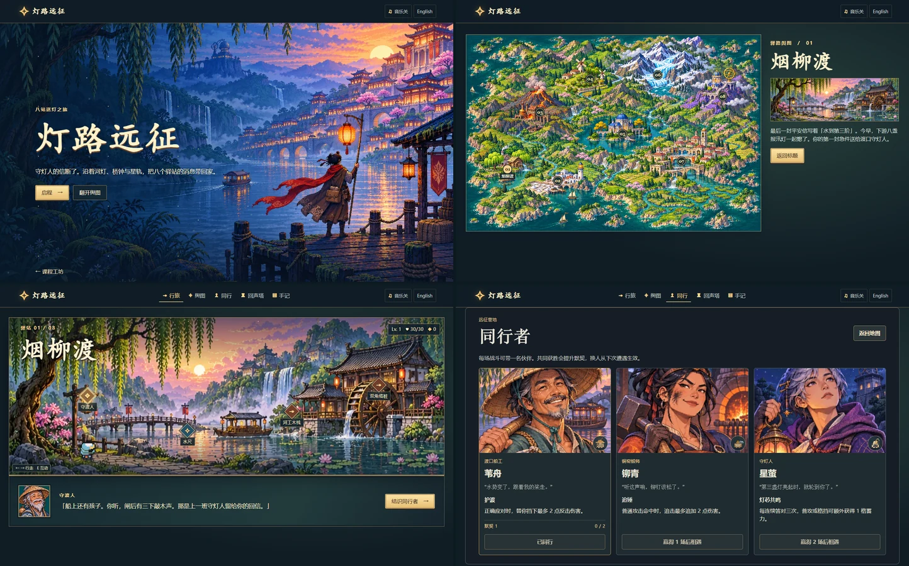

# 灯路远征

在仓库根目录运行 `python run.py`（Windows 也可双击 `start.cmd`），在工作室点 **进入远征 RPG**。浏览器在已经启动的服务地址后打开 `/rpg/` 也能进入同一游戏。游戏在 FastAPI 上读取关卡、存档与结算。将 HTML 文件单独拖进浏览器无法建立会话。

[观看实机短片](media/lantern-road.mp4)。片中经过舆图、渡口、伙伴交谈、机关、货栈出招和塔门。第一站遇到栈或队列的课程内容时可以直接操作货栈；普通生物题使用知识刻印。三个箱子从单门栈依次弹出 C、B、A，玩家可把观察到的顺序或机制装入战技。[货栈实机画面](media/rpg-cargo-dock.webp)

## 第一次出发

1. 在标题画面选“启程”，选择职业。自带的驿站通识手册含中英两版、32 个知识点，首次准备会生成八地区、十六章。也可以从本机选一至八份课程文件，使用资料里带出处的知识生成一至八个地区。每卷最多两章、每章至少一道题。当前界面语言决定自带手册语言。
2. 点击场景中的守站人交谈，调查地标，或用方向键在前景移动，按 E 与最近的地点互动。步行经过有敌人的路口会开战。各地的近道设有缆绳绊索、炉轨压板或裂冰暗板等机关，触动后精英守卫出现。通过鼠标、键盘焦点或触摸选择路线，也可先看清奖励、风险和遭遇说明，再确认出发。
3. 站内有八种机关，从渡缆、浮标、扳机、风索到透光台、路铃、音叉和日环。根据守站人的线索调好刻度并动手操作，获得本站的一份信物；首次修复按当前生命缺口最多恢复 3 HP。服务器保存信物、体力和队伍，同一站只能领一次。手记可以查看收集情况。
4. 战场上先看敌方意图，选择普攻、格挡或职业战技，将知识刻印装入法阵后出手。战败会进入营地重读课件并修习，完成后回到原来的敌人。每章结束可以用路币休息、买遗物或强化装备。末章完成后打开归航手记，可进入进阶周目。
5. 在“同行”里交谈并选一名伙伴上阵。渡口船工替队伍挡伤，锻师在普攻击中时追锤，守灯人协助蓄力。同行经历提高默契。回声塔和主线共用这支队伍，分别保存战场。塔层逐步从辨认、回忆发展到拼接多条证据。[回声塔与伙伴规则](rpg-tower-party.md)
6. 手记按已作答的知识点登记讲义原文、出处、正确次数。中英按钮可在探索、战斗、爬塔和读课件时使用。自带界面与故事有两种语言，玩家自带讲义保留原始术语与公式。[课程格式与实测记录](course-rendering.md)

## 故事与游戏设计

剧情采用社区战役《韦诺之战》经典版 *The South Guard* 的叙事结构：边区来信中断，年轻旅人前往查访，先帮助沿路居民，再从地方证词发现危机全貌。灯路中的八个地区来自项目原有远征图鉴。这里为它们补写驿信、人物对话、机关与一个贯穿八站的结局。旅人在复写馆发现调令被统一改写，在日轨天台遇见为了预防洪水而将八盏灯接到同一座钟上的守台人。小型自定义课程会在实际走过的最后一站收束。参考资料是社区公开梗概，人物、对白、地理和图像为本项目的创作。[The South Guard 故事梗概](https://wiki.wesnoth.org/South_Guard_story)

地图、地点日志、营地和楼层守护者参考了社区 RPG 以区域划分图鉴、让玩家从敌方行为中理解规则的做法。回声塔将高层压力放在证据组合、连续正确与敌方属性上。战斗的学习价值、主观难度与疲劳度仍适合用组员和同学试玩衡量。[Shattered Pixel Dungeon 作者仓库](https://github.com/00-Evan/shattered-pixel-dungeon)

## 实现与接手

| 入口 | 职责 |
| --- | --- |
| [world.js](../public/rpg/world/world.js)、[interface.js](../public/rpg/world/interface.js) | 标题、开局、漫游、点击与键盘交互、地图、补给、手记、结局、挂载与卸载战场 |
| [provision.js](../public/rpg/world/provision.js)、[fieldbook.js](../public/rpg/world/fieldbook.js) | 上传、提取、分卷、规划、确认发布、建立存档；分步记录 job ID，支持断线接续 |
| [atlas.js](../public/rpg/world/atlas.js)、[地区美术](../public/rpg/world/region-art/ASSETS.md) | 地图坐标、地区风景、居民证词、地标和各站结局 |
| [weather.js](../public/rpg/world/weather.js)、[music.js](../public/rpg/world/music.js) | 每区环境光、雪、浮沫、碎叶、余烬、星光和八段分区乐句；切后台暂停，配乐由用户开启 |
| [战斗组件](rpg-battle-frontend.md)、[塔和伙伴](rpg-tower-party.md) | 回合回执、阶段切换、成长与塔层 |
| [远征服务](../backend/rpg/expedition_routes.py) | 会话与幂等操作、实时学习笔记、通关战报和周目 |
| [端到端验收](../tests/browser/lantern-road.spec.js) | 从工作室游戏入口创建八地行程、调整渡口机关、刷新、招募和遭遇 |

浏览器地址中的 `?session=` 可恢复该服务的一份远征。战斗生命、奖励、机关进度、学习证据和塔层以 SQLite 为准。音量、简化动效和界面语言属于本机偏好。游戏数据与截图请按课程授权使用；仓库只附项目自制手册和公开示例。

## 整程验收

使用内置讲义从正常网页入口开局，依次在八地调查、选择路线、作答并领取十五次章间补给。十六章共 44 次正确出招，最终收集八枚信物、登记 32 条带讲义出处的知识记录。刷新后结局数据一致，再从结局开启独立的进阶周目。另用三个职业分别打通回声塔前十二层。原有八卷 32 章模拟用 24 组职业、装备和路线组合全部通关。课程的实测情况见[跨学科验收记录](course-rendering.md)。
