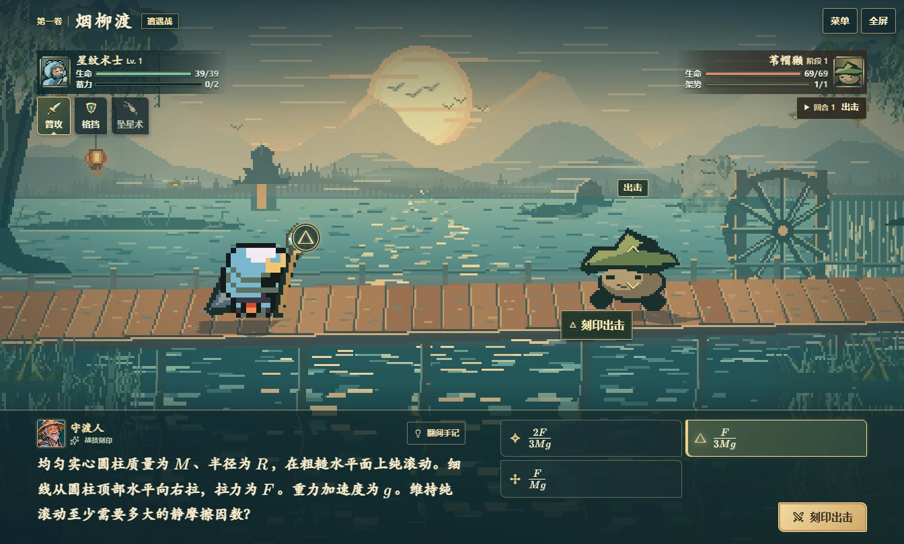
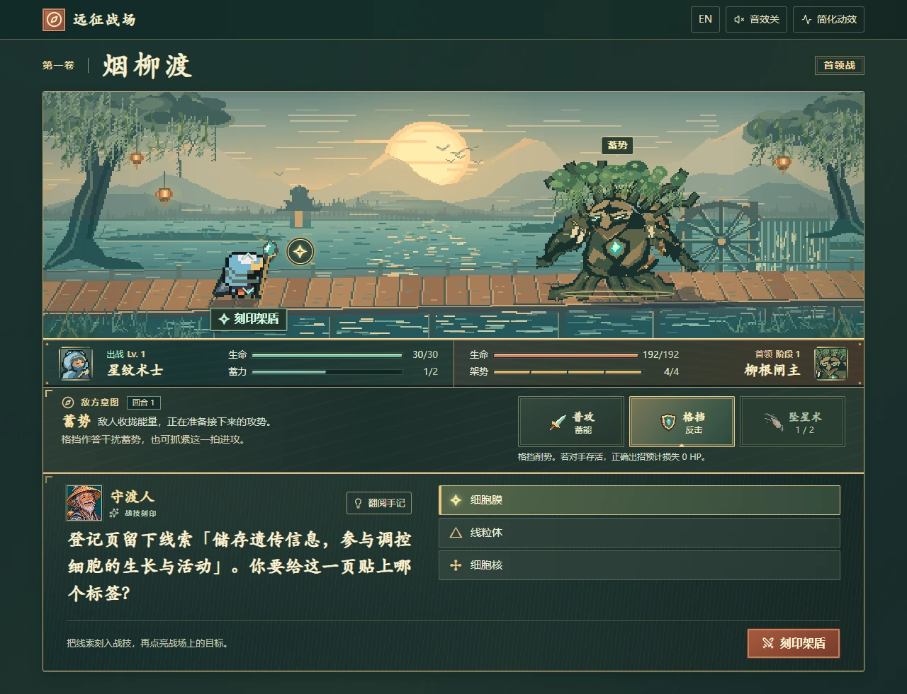

# 烟柳渡战斗前端交接

一个可以从开场打到结算的答题战场。独立试玩用细胞生物学讲义生成一章，玩家操纵星纹术士，对阵柳根闸主。接进主站后，同一组件读取玩家已经创建的远征存档，使用该局的职业、装备、题目、敌方意图和进度。



这场实战使用自编的力学练习。选中刻印后可直接点敌人出招，命中时血条与伤害飘字一起变化，最后一击的解析、经验、掉落和补给都能留在渡口查看。[观看这场战斗](media/field-battle.mp4)

## 接手先跑一局

1. 在仓库执行 `git fetch origin` 和 `git switch feature/rpg-battle-frontend`。开发基线是 `rpg-backend` 的 `7f3e140`，这两个分支共用同一版远征 API。
2. 使用 Python 3.11 或更高版本。在根目录执行 `python run.py`，Windows 也可双击 `start.cmd`。首次安装依赖需要联网，保留服务终端。
3. 在启动器打开的地址后加上 `/rpg/battle/`。端口以终端打印值为准。页面由同一 FastAPI 服务提供，所有美术、图标和音效都在本地运行。
4. 点 **进入首领战**。首次启动会上传自带的细胞讲义、准备一章六题、确认出版、开远征、选择稳妥首领路线。课堂演示用默认的 `offline` 模式。有自建配置时，可在 PowerShell 执行 `$env:EDUGAME_MODE='offline'` 后重启本项目。手里已经有存档时，可直接打开 `/rpg/battle/?session=<远征编号>`，已有存档也支持模型模式生成的课程。
5. 先读敌方预告，选普攻或格挡，把材料线索刻进手中的符文，然后点击战场上带印记的目标，或用底部的出招按钮。普通攻击积蓄职业技，蓄满时战技按钮点亮。营地复习会显示讲义的概念、定义和出处，完成巩固后自动回到刚才的敌人。通关结算展示服务器发放的经验、等级变化与装备。独立试玩可以再开一局。

烟柳渡有专属场景与首领造型。其他七个地区各有独立场景，按图鉴类别选择敌方立绘。打开 [/rpg/](../public/rpg/index.html) 可从世界地图开始远征，独立入口适合展示渡口一战。

主线、回声塔和独立入口的战场都铺满浏览器视口。左右血条各自对应桥上的角色，底部显示本回合的题干和选项。选项中的短公式随文字排版，超宽公式支持触屏横移与键盘阅读。手机上的长题可以在底部区域内滚动，角色和血条始终留在原位。

结算后点 **回合解析** 或 **最后一击解析** 可查看服务器确认的伤害、当前解题思路及材料出处，按 Esc 或关闭按钮即可返回。点击 **前往营地** 可在原景挑选本章补给。主线使用右上菜单调节战斗音效和简化动效，独立入口使用右上设置。

## 让知识决定这一击

战斗画面、血条、敌方预告和刻印台共用一个游玩界面。每地的守灯人递来课程线索，玩家先选战技，再把对应的刻印装到手边。符文亮起后，可直接点击敌方或己方的目标标记释放招式。战技的受击预测读取服务端预演的数值。普攻命中累积蓄力，格挡可截断蓄势，给本章的下一回合留下破势窗口。键盘聚焦战斗后，Q/W/E 切战技，数字选符文，Tab 和 Enter 完成释放。屏幕上的按键支持触控和读屏操作。

两栏次序题让玩家先嵌首印、再嵌尾印，可撤回重组。界面按已发布的可选组合匹配选项编号，评分仍由后端完成。无尽塔有多条证据需要同时核验时，可在全览和独立线索间切换，分别比较同一符文如何对应不同证据。常规题直接选择整条证据。题目、线索、答案、营地手记和回合讲解共用本地课程排版器。伙伴支援显示本回合的协击、拦截或蓄力实数。中文和英文可在战斗中直接切换，编辑中的组合也会保留，上传的课程原文按原语言展示。

首卷的数据结构题会开放渡口货栈。可以逐箱装入 A、B、C，操作队列与栈的闸门，比对真实的出货顺序。当原题提供同组货箱的排列，或同时给出可区分的栈与队列选项时，可将自己测出的顺序或机制直接刻进战技，选错机制同样会受到敌人反击。其他类型的题维持原来的评分规则。这项实验使用本地确定性队列与栈，预览操作不消耗生命、回合或提示次数。[来自首卷真实课程的货栈界面](media/rpg-cargo-dock.webp)

设计参考了《星之海》对蓄力敌招的预告和打断，以及《蒸汽世界冒险》将手中卡片直接用于战斗的交互。像素素材和代码的授权见本文后段。[Sea of Stars](https://seaofstarsgame.co/) | [SteamWorld Quest](https://store.steampowered.com/app/804010/SteamWorld_Quest_Hand_of_Gilgamech/)

## 把战场嵌进地图

在宿主页引入一次样式。模块和素材使用各自的相对路径，无需打包，也无需全局游戏引擎。

```html
<link rel="stylesheet" href="/rpg/battle/battle.css">
<link rel="stylesheet" href="/rpg/world/combat-viewport.css">
<div id="encounter"></div>
```

地图负责将 `choose_route` 的回包交给战场。下面的 `renderMap`、`renderCamp` 与 `renderReport` 是宿主自己的页面函数。战场挂载时会读取最新进度，刷新进入战斗或巩固状态时也走这个入口。

```js
import { mountBattle } from '/rpg/battle/battle.js';

function enterEncounter(sessionId) {
  const container = document.querySelector('#encounter');
  const battle = mountBattle(container, {
    sessionId,
    immersive: true,
    onExit(current) {
      battle.destroy();
      if (current.phase === 'reward') return renderCamp(current);
      if (['victory', 'retreated'].includes(current.phase)) {
        return renderReport(current.session_id);
      }
      return renderMap(current);
    },
  });
  return battle;
}
```

| 接口 | 约定 |
| --- | --- |
| `mountBattle(container, {sessionId, onExit, onViewChange})` | 同步返回组件句柄。传入远征顶层 `session_id`。宿主通常直接用 `onExit(latestView)` 切页。 |
| `handle.ready`、`handle.getView()` | 等待首次读取后，可取最新一次已呈现的 `ExpeditionView`。首次读取失败时页面给出重试入口，当前值为 `null`。 |
| `immersive` | 设为 `true` 并加载上面的两份样式即可采用全屏战场。默认值 `false` 适合嵌在其他可滚动页面内。 |
| `controller` | 可选依赖，提供 `load`、`send`、`retry`、`hasPending` 和 `resynced`。无尽塔借此适配自己的命令与楼层视图。 |
| `onViewChange(view)` | 可选。首次读取和后续服务器回包呈现后通知宿主，可同步侧栏进度。 |
| `handle.destroy()` | 路由切走时调用，清理事件、舞台和音效。再次打开同局时用原编号重新挂载。 |
| `battle-exit` | 嵌入时如未传 `onExit`，玩家点击结束按钮会从容器冒泡此事件，`event.detail` 为当前视图。 |
| `standalone`、`savedEntry` | 独立入口内部选项。地图嵌入传 `sessionId` 即可。 |

`phase` 使用**远征顶层**的字段。`combat` 与 `sidequest` 继续在组件内游玩。`reward` 显示本章所得，玩家读完后由宿主选择补给。`route` 交回地图。`victory` 与 `retreated` 交回结果页面，宿主可调用 `GET /rpg/expeditions/{session_id}/report`。在多卷远征中，一卷胜利时嵌套的 `battle.phase` 可能已是 `victory`，整段旅程仍在继续。

## 一个回合怎样走完

| 时刻 | 客户端动作 | 服务端依据 |
| --- | --- | --- |
| 读招 | 显示敌方意图、阶段、生命与架势，面板显示职业、生命与蓄力 | `battle.tactics`、`battle.enemy`、`player` |
| 选招与作答 | 两项选择先留在本页，点确认才提交。营地巩固回合固定使用 `strike` | `battle.prompt.prompt_id`、`options[].id`、`player.burst_ready` |
| 提交 | 向 `POST /rpg/expeditions/{session_id}/actions` 提交 `answer`、招式、答案、一次性的 `event_id` 与远征顶层 `expected_revision` | 服务端判题、扣血、破势并结算 |
| 呈现 | 锁定输入，敌方中招时先更新敌方生命和架势，我方受到反击时再更新我方生命。动作收束后显示下一题或结算。打开“上一回合”可读讲义解释与出处 | `battle.last_event` 与下一份公开视图中的生命、架势和蓄力 |
| 提示与补课 | 点“查看提示”提交 `hint`。失利后打开营地讲义，完成后原存档进入同一遭遇 | `battle.prompt.hint`、`battle.sidequest.lesson`、顶层 `phase` |

同一标签页在发送前保存待确认的事件。点击两次只发送一次；断线重连先读服务端版本，仍待结算时使用原事件号与原参数。另一窗口已推进或服务返回 409 时，读取最新状态。独立试玩单独记住上次的会话，嵌入时以宿主提供的编号为准。浏览器存储只用于保存接口编号、设置和未确认动作。战斗真值、判题、奖励、学习记录由后端维护。

## 文件与接手边界

| 要改的内容 | 从哪里开始 |
| --- | --- |
| 独立启动、已有存档入口 | [index.html](../public/rpg/battle/index.html)、[entry.js](../public/rpg/battle/entry.js)、[demo.js](../public/rpg/battle/demo.js) |
| 组件生命周期和本回合输入 | [battle.js](../public/rpg/battle/battle.js) |
| 题目、意图、血条、学习记录、结算面板 | [panels.js](../public/rpg/battle/panels.js)、[battle.css](../public/rpg/battle/battle.css) |
| 展示动作、镜头、音效、像素角色 | [stage.js](../public/rpg/battle/stage.js)、[stage.css](../public/rpg/battle/stage.css)、[素材来源和许可](../public/rpg/battle/art/ASSETS.md) |
| 请求、重连、幂等与版本 | [controller.js](../public/rpg/battle/controller.js)、[公共视图样例](rpg-fixtures/battle-ui/willow-boss.public.json)、[视图 Schema](../schemas/rpg/ExpeditionView.schema.json) |
| 地图、补给、课程、战报的后端约定 | [八卷远征](rpg-expedition.md)、[RPG 后端交接](rpg-backend-handoff.md) |

1. 主站先在地图页接通一个真实 `session_id`，跑完一章，检查接手的 `revision` 与服务端相同。
2. 地图负责选路，营地负责 `choose_reward`。进入下一章沿用同一存档。不要在主站重复计算伤害或发放装备。
3. 新地区先按 `map[region_index].region_id` 扩展背景。专属敌人按 `battle.tactics.encounter_id` 选图，其余使用 `battle.enemy.sprite` 的类别。新动效优先接 `last_event.tactics`，同时给简化动效模式保留文字结果。
4. 新增文案可沿用 `displayText` 和安全转义。用户资料与题面作为文本处理，重要判题措辞如果无法原样呈现，界面会要求回课程页调整。静音默认开启，简化动效初始值跟随系统，玩家可随时切换。

## 动效与素材来源



**场景按存档进度呈现。** 开战时是渡口夕照。柳根闸主进入第二阶段时，胸芯由青玉变成琥珀，铜榫上的亮纹和急流同时提示危险。战败后营地使用月色与炉火，击败闸主后才表现开闸与行船。刷新直接呈现当前状态。其他七地根据地图地点加载自己的绘景和天气，保留相应的敌方身形。营地、胜利、重试和角色养成沿用远征已有规则。

| 要接手的视觉细节 | 实现与数据 |
| --- | --- |
| 渡口天色、江面、垂柳、火光、船夫和开闸 | [像素材质调色](../public/rpg/battle/effects/ferry-palette.js)、[近远景绘制](../public/rpg/battle/effects/living-ferry.js)。由远征阶段、遭遇编号和首领阶段选择场景。 |
| 举杖、拉弓、挥刀、守卫架盾与受击 | [角色姿势](../public/rpg/battle/effects/actor-poses.js)、[图集来源与格位](../public/rpg/battle/art/POSES.md)。动作跟随同一时间线，静态读招姿势取自公开敌方意图。 |
| 职业和敌方肖像、战技徽章、分格资源条 | [指令台与命中更新](../public/rpg/battle/panels.js)、[图标与肖像出处](../public/rpg/battle/ui/ASSETS.md)。确认答案前，瞄准标记区分攻击对象和防守角色。 |

本轮选取分享中三份公开制作记录作为参考。*Forest Walks* 用固定地标、夕照与营火塑造同一地点。*Dot Rumble* 的姿态与接触点帮助校正了角色的举手、放箭和受击时机。*Phantasy Codex Adventure* 的地区地标和战斗反馈启发了开闸通航这个可见结果。场景绘制、姿势编排和游戏动作均在本项目实现。[Forest Walks](https://developers.openai.com/showcase/forest-walks) ｜ [Dot Rumble](https://developers.openai.com/showcase/dot-rumble) ｜ [Phantasy Codex Adventure](https://developers.openai.com/showcase/phantasy-codex-adventure)

**调招式时先看接触点。** 舞台以 168 个逻辑像素为高，从实际角色框计算攻击落点。普通攻击在 430 毫秒接触，格挡在 480 毫秒，职业技在 680 毫秒。命中会短暂定格角色、轨迹和碎片，同时更新伤害数字与状态条。每次提交只消费一份回执。

| 修改目标 | 入口 |
| --- | --- |
| 角色出手、星仪与陨星、拉弓贯穿、先锋剑弧 | [hero-effects.js](../public/rpg/battle/effects/hero-effects.js) |
| 敌方中招、铜闸破势、水浪、树根反击、格挡接触 | [impact-effects.js](../public/rpg/battle/effects/impact-effects.js) |
| 水面和木桥反光、法杖声、弦鸣、碎甲声 | [ferry-light.js](../public/rpg/battle/effects/ferry-light.js)、[audio.js](../public/rpg/battle/effects/audio.js) |
| 出手与反击的时间线、镜头、定格、静态数字、切后台清理 | [stage.js](../public/rpg/battle/stage.js)、[逐帧浏览器测试](../tests/browser/rpg-effects.spec.js) |

各绘制函数按传入的回合时间采样，重录和逐帧验收可以复现同一动作。简化动效模式沿用相同回执，直接呈现静态结果。在系统隐藏页面、宿主卸载组件或中途开启简化动效时，舞台会清理动画。

B 站示例逐层演示命中停顿、震屏、受击闪白、击退形变、粒子与伤害数字、分层音效。本项目把这些反馈分别绑定到出手方和受击方，并按后端报告的动作选择表现。视频用于分析动作节奏。项目只分发本项目的实现和许可明确的开放素材。[参考视频《Godot打击感怎么做？把这一刀拆成6层》](https://www.bilibili.com/video/BV1kvWg6aEdP/)

回合演出顺序参考了 Pokémon Showdown 客户端消费事件并等待动画完成的做法。原生 DOM 负责题目与操作，像素舞台负责演出，分工参考 Phaser 官方游戏场景向 UI 场景发消息的示例。[Pokémon Showdown 战斗源码](https://github.com/smogon/pokemon-showdown-client/blob/master/play.pokemonshowdown.com/src/battle.ts) | [Phaser UI Scene 示例](https://github.com/phaserjs/examples/blob/master/public/src/scenes/ui%20scene.js)

像素角色使用 Pixel-Boy 与 AAA 的 Ninja Adventure 开放素材。使用的资源及改绘方式见美术目录内的来源清单。操作图标保留了 Lucide 上游许可证，取自固定版本。[Ninja Adventure 作者页面](https://pixel-boy.itch.io/ninja-adventure-asset-pack) | [Lucide 图标版本](https://github.com/lucide-icons/lucide/tree/742ea78395b4122e13fd46743caba5140f47fb66/icons) | [图标许可证](../public/rpg/battle/icons/LICENSE)

## 验收方式

在仓库根目录运行以下命令。Python 测试依赖在 `requirements-dev.txt`，浏览器测试使用 Node 22 或更高版本。Windows 默认使用本机 Edge，其他平台可运行 `npx playwright install chromium` 安装 Chromium。Playwright 会启动独立的离线 FastAPI 服务。

```sh
npm ci
npm run check
npm test
npm run test:e2e
python -m pytest -q
```

[首领战浏览器验收](../tests/browser/rpg-battle.spec.js)使用公开讲义作答，与真实 HTTP 回包、存档和战报核对。试跑时可主动失败一次，检查营地笔记里的课程出处，刷新后完成巩固，再挑战同一首领。[控制器测试](../tests/rpg-battle-controller.test.js)可以单独复核重试、并发和独立开局逻辑。

回归覆盖主线和独立入口的完整视口、攻防、胜利与营地，跨章继承装备和经验，以及单独嵌入其他页面时的手机战斗小窗。缩放和触摸测试检查短分式的实际滚动宽度、长公式的阅读与选项点击。[主线游玩](../tests/browser/rpg-saga.spec.js) | [跨章节验收](../tests/browser/rpg-battle-camp.js) | [公式回归](../tests/browser/formula-overflow.spec.js)
