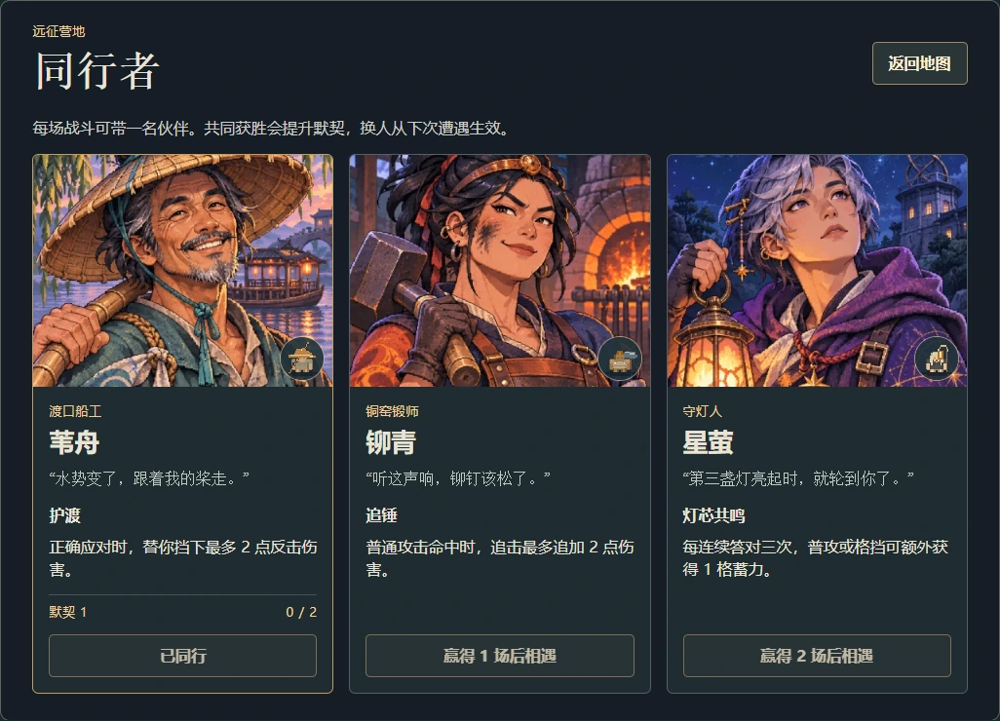

# 回声无尽塔与同行者

从远征地图打开星台或同行者名册。沿途与伙伴交谈即可招募。每场战斗在进场时锁定一名同行者，派遣新伙伴会影响下一场遭遇。切回主线或关掉标签页后，可以继续同一次爬塔。课程删除会通过远征已有的外键清理整份存档。

## 塔层规则

每层从本次远征已发布的课程中轮换一卷，重新选取其已核验的知识点。所有判题、伤害、经验、装备和默契均由服务端结算。首次入塔继承当时角色的职业、经验与装备，后续塔内升级和掉落在塔内延续。每次登上新层时英雄恢复至满血。塔内通关和主线通关都会积累队伍默契。

| 塔层 | 需要玩家做的事 |
| --- | --- |
| 1 | 从三个选项中认出讲义中的正确记录。 |
| 2 至 3 | 从定义回忆术语。资料中有足够的独立知识点时，备选项从三项增加至四项。 |
| 4 至 6 | 同时核对两条已发布题目，找出两条线索都正确的组合。 |
| 7 及以后 | 同时核对三条题目。每组干扰项至少更换一条线索，错项对应的原知识点进入战败复习。 |

每一层的守卫生命为 `50 + 11 × 层数 + floor(层数² / 15)`，基础反击强度为 `8 + 2 × 层数`。塔层 1、4、7、10 起，终结守卫分别要求连续答对 1、2、3、4 次，此后每三层再增加一次。守卫暴露弱点、职业战技和正确防守均沿用主线规则。一次完美格挡可以消解重击。讲义覆盖范围决定可组成几道不同线索，窄范围课程自动保留单题或双题。层数没有预设终点。

| 伙伴 | 相遇条件 | 战斗作用 |
| --- | --- | --- |
| 苇舟 Reed | 起点可结交 | 正确应对时减免反击伤害，等于默契等级加一，上限为当前实际来伤。 |
| 铆青 Flint | 主线和塔层累计一胜 | 普攻命中后追击，最多追加默契等级加一的伤害，仍须亲自解决待学知识和首领阶段。 |
| 星萤 Lumen | 累计两胜 | 每第三次连续正确应对时，普攻或格挡额外获得一格蓄力，默契三级起可额外获得两格。 |

一名伙伴实际参加并赢得一场战斗即可增加一点默契。在 0、2、5、10 胜分别达到一级至四级。每个地区在地图阶段首次调查地标将记录该地印记，并恢复至多三点生命。再次调查可重读发现。

## 对接

`GET /rpg/expeditions/{id}` 会给出 `companions`、`field_signals` 和 `tower`。原有动作端点继续使用 `expected_revision` 与 `event_id`。支持 `inspect_landmark`、`recruit_companion`、`assign_companion`、`tower_enter`、`tower_answer`、`tower_hint` 和 `tower_equip`。爬塔页面与战斗页共用答题舞台和已发送回合的恢复机制。离开塔门直接返回地图，进行中的塔层会保留。

| 入口 | 职责 |
| --- | --- |
| [tower.py](../backend/rpg/tower.py) | 塔层选题、入场、通关、职业装备延续 |
| [battle_content.py](../backend/rpg/battle_content.py) | 单次回忆题和多线索组合题、来源和私有答案 |
| [companions.py](../backend/rpg/companions.py) | 交谈结交、派遣和默契等级 |
| [tower.js](../public/rpg/tower/tower.js) | `mountTower(container, {sessionId, onExit, onViewChange})` |
| [party.js](../public/rpg/tower/party.js) | `mountParty(container, {sessionId, onExit, onViewChange})` |

两个挂载函数都同步返回带 `ready` 和 `destroy()` 的对象。地图切换地点时调用 `destroy()`；宿主收到的 `onViewChange` 始终是完整的远征视图。战斗的 `tactics.companion_id` 对应实际同行者，`last_event.partner_assist` 给出本回合生效的援助种类和实际数值。

## 平衡与实测

使用内置细胞讲义、巡途行装与初始伙伴，先锋、游侠和术士各自连续通关前十二层。三职业分别用了每层 4 至 5、4 至 5、4 至 5 个回合。操作策略是接住蓄势和重击，蓄力足够时释放职业战技，其余回合普攻。这个结果适用于熟悉讲义的固定战术玩家。

首层另以单人队伍测试不同掌握程度。全对时三职业均用四回合通关，每四次答错一次时用五至六回合通关且剩余生命更少。固定交替对错或持续答错时，三职业均进入带原讲义摘记的复习支线。再次作答后恢复同层挑战。浏览器验收使用 390 像素视口，从结交、作答、恢复回合、结算直到登上第二层。[后端平衡测试](../tests/test_tower_party.py) ｜ [手机浏览器验收](../tests/browser/rpg-tower.spec.js)

## 美术来源

`companions.png` 中三位地图伙伴的衣着、身体和发型来自 Kenney 的《Roguelike Characters》2.0，在本项目组合并绘制斗笠、船桨、锻锤和灯笼。原包使用 CC0。[Kenney 原包及许可声明](https://kenney.nl/assets/roguelike-characters) ｜ [CC0 全文](../public/rpg/battle/art/CC0-1.0.txt)

`crew-portraits.webp` 是本项目使用 OpenAI ImageGen 为船工、锻师和守灯人生成的独立角色肖像。三格并排，每格 384 × 384，可按当前同行者 ID 在对话中复用。星台门厅使用远征星台场景原画。
